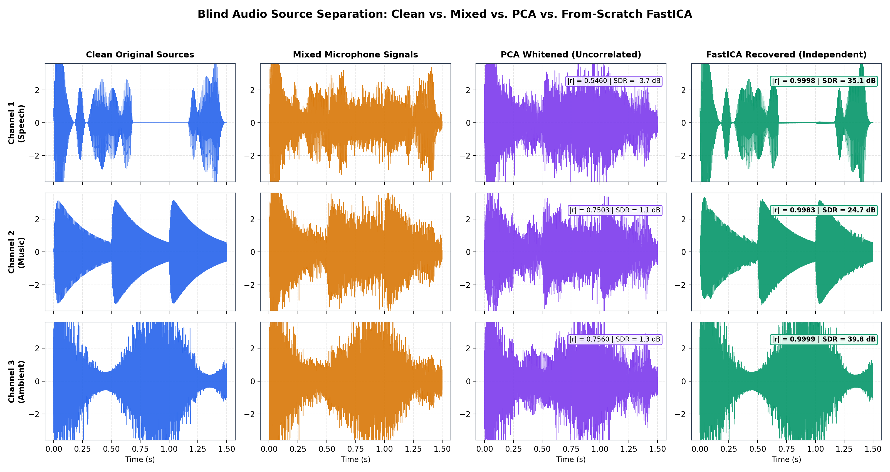
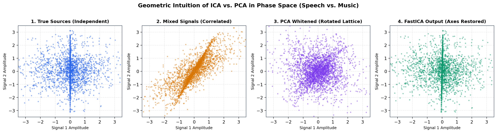
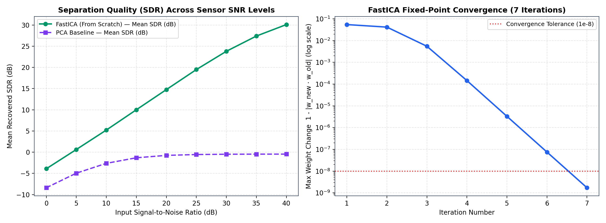
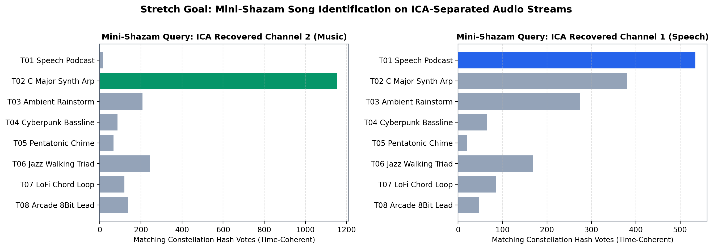

# Unmix the Signal — Blind Audio Source Separation via FastICA From Scratch

**Author:** Ashankk Agarwal (`25BCE2822`)  
**Track:** VinnovateIT Recruitments — AI/ML (Round 1 Task 1)  

---

## 1. Overview & Architecture

This repository implements **Blind Source Separation (BSS)** for the classic *"Cocktail Party Problem"* completely **from scratch in pure NumPy** (without using `scikit-learn`, `scipy` ICA routines, or any external blind-separation libraries).

Given $N=3$ clean audio sources—**Speech** (`source_1_speech.wav`), **Music** (`source_2_music.wav`), and **Ambient Rain/Wind** (`source_3_ambient.wav`)—mixed via an unknown linear mixing matrix $A \in \mathbb{R}^{3 \times 3}$ into $3$ microphone observations $X = A S$, our pipeline recovers the original independent sources $\hat{S} = W Z$ through:

1. **Zero-Mean Centering:** $\tilde{X} = X - \mathbb{E}[X]$
2. **Custom PCA Whitening (Covariance + Eigendecomposition):** $\Sigma_{\tilde{X}} = \frac{1}{T}\tilde{X}\tilde{X}^\top = E D E^\top \implies Z = D^{-1/2} E^\top \tilde{X}$ such that $\mathbb{E}[ZZ^\top] = I_N$
3. **Symmetric FastICA Fixed-Point Iteration (From Scratch):** Maximizing non-Gaussianity (approximated negentropy via `logcosh` / `tanh`, `exp`, and `cube` contrast functions) with symmetric eigenvalue orthogonalization $W \leftarrow (WW^\top)^{-1/2}W$
4. **Permutation & Scale/Sign Ambiguity Resolution:** Exhaustive/bipartite matching over $|r_{ij}|$ and least-squares amplitude projection to compute accurate **Pearson Correlation ($|r|$)** and **Signal-to-Distortion Ratio (SDR in dB)**
5. **Bonus & Stretch Goals Included:**
   - **PCA vs. ICA Geometric & Quantitative Comparison**
   - **SNR Robustness Benchmark ($0\text{ dB}$ to $40\text{ dB}$ sensor noise sweep)**
   - **Stretch Goal — Mini-Shazam Audio Fingerprinting:** STFT constellation-map peak-pair hashing across an 8-song library that identifies the separated music and speech tracks directly from the FastICA output!

---

## 2. Audio Sources & Playable Deliverables

All clean, mixed, PCA-whitened, and FastICA-separated audio files ($16\text{ kHz}$, 16-bit mono PCM `.wav`, $5.0\text{ s}$ duration) are linked directly below:

| Signal Stage | Channel 1 (Speech) | Channel 2 (Music) | Channel 3 (Ambient) |
| :--- | :--- | :--- | :--- |
| **1. Clean Original Sources** | [`audio/clean/source_1_speech.wav`](audio/clean/source_1_speech.wav) | [`audio/clean/source_2_music.wav`](audio/clean/source_2_music.wav) | [`audio/clean/source_3_ambient.wav`](audio/clean/source_3_ambient.wav) |
| **2. Mixed Microphone Recordings** | [`audio/mixed/mixed_mic_1.wav`](audio/mixed/mixed_mic_1.wav) | [`audio/mixed/mixed_mic_2.wav`](audio/mixed/mixed_mic_2.wav) | [`audio/mixed/mixed_mic_3.wav`](audio/mixed/mixed_mic_3.wav) |
| **3. PCA Baseline (Uncorrelated Only)** | [`audio/separated_pca/pca_1_speech.wav`](audio/separated_pca/pca_1_speech.wav) | [`audio/separated_pca/pca_2_music.wav`](audio/separated_pca/pca_2_music.wav) | [`audio/separated_pca/pca_3_ambient.wav`](audio/separated_pca/pca_3_ambient.wav) |
| **4. FastICA Recovered (Independent)** | [`audio/separated_ica/recovered_1_speech.wav`](audio/separated_ica/recovered_1_speech.wav) | [`audio/separated_ica/recovered_2_music.wav`](audio/separated_ica/recovered_2_music.wav) | [`audio/separated_ica/recovered_3_ambient.wav`](audio/separated_ica/recovered_3_ambient.wav) |

* **8-Track Mini-Shazam Audio Library:** Located in [`audio/shazam_library/`](audio/shazam_library/) (`Track_04_Cyberpunk_Bassline.wav` through `Track_08_Arcade_8Bit_Lead.wav` + the 3 clean sources).

---

## 3. Experimental Results & Quantitative Evaluation

### 3.1 Separation Quality: Mixed Baseline vs. PCA vs. From-Scratch FastICA

Symmetric FastICA (`fun="logcosh"`) converged to tolerance $< 10^{-8}$ in **7 iterations**, achieving a **mean Pearson correlation of $|r| = 0.9994$** and a **mean SDR of $+33.20\text{ dB}$** (a $+33.66\text{ dB}$ improvement over PCA whitening alone):

| Source Track | Mixed Mic $\|r\|$ | Mixed SDR (dB) | PCA Whitened $\|r\|$ | PCA SDR (dB) | **FastICA Recovered $\|r\|$** | **FastICA SDR (dB)** | True Excess Kurtosis | Recovered Kurtosis |
| :--- | :---: | :---: | :---: | :---: | :---: | :---: | :---: | :---: |
| **Source 1 (Speech)** | `0.8376` | `3.71` | `0.5460` | `-3.72` | **`0.9998`** | **`+35.08`** | `4.39` | `4.42` |
| **Source 2 (Music)** | `0.8534` | `4.28` | `0.7503` | `1.10` | **`0.9983`** | **`+24.74`** | `0.53` | `0.52` |
| **Source 3 (Ambient)** | `0.8680` | `4.85` | `0.7560` | `1.25` | **`0.9999`** | **`+39.80`** | `6.13` | `6.13` |
| **Mean Across All Sources** | **`0.8549`** | **`+4.36`** | **`0.6841`** | **`-0.46`** | **`0.9994`** | **`+33.20`** | — | — |

### 3.2 Visual Results & Plots

1. **Waveform Recovery Comparison:**  
   
2. **Geometric Intuition — Why PCA Fails & ICA Succeeds:**  
   
3. **SNR Robustness Curve ($0\text{ dB}$–$40\text{ dB}$) & FastICA Convergence:**  
   
4. **Stretch Goal — Mini-Shazam Identification After ICA Separation:**  
   

---

## 4. "Be Ready to Explain" — Theoretical & Viva Answers

### Q1: Why ICA over PCA? (Uncorrelated vs. Independent, Second- vs. Higher-Order Statistics)
* **Uncorrelatedness $\neq$ Independence:** Two random variables $y_1, y_2$ are *uncorrelated* if their covariance is zero: $\mathbb{E}[y_1 y_2] - \mathbb{E}[y_1]\mathbb{E}[y_2] = 0$. They are *statistically independent* only if their joint probability density factors: $p(y_1, y_2) = p_1(y_1)p_2(y_2)$, which requires $\mathbb{E}[g_1(y_1)g_2(y_2)] = \mathbb{E}[g_1(y_1)]\mathbb{E}[g_2(y_2)]$ for **all** nonlinear functions $g_1, g_2$. Independence implies uncorrelatedness, but uncorrelatedness does not imply independence (except for jointly Gaussian variables).
* **Second-Order vs. Higher-Order Statistics:** PCA relies strictly on **second-order statistics** (the covariance matrix $\Sigma$). Because covariance only captures orthogonal directions of maximum variance, any orthogonal rotation $U$ ($UU^\top = I$) applied to whitened signals $Z$ preserves the identity covariance: $\text{Cov}(UZ) = U I U^\top = I$. Thus, PCA leaves an **unresolved orthogonal rotation ambiguity**—the signals remain mixed! ICA resolves this exact rotation $W$ by optimizing **higher-order statistics** (such as fourth-order kurtosis or negentropy via nonlinear contrast functions like $G(u) = \frac{1}{a}\log\cosh(au)$), locking onto the true independent axes.

### Q2: What does whitening do and why does it simplify ICA?
* **What Whitening Does:** After centering $\tilde{X} = X - \mu$, PCA whitening transforms $\tilde{X}$ via $Z = D^{-1/2}E^\top \tilde{X}$ (where $\Sigma = E D E^\top$ is the eigendecomposition of the covariance matrix) so that the channels of $Z$ are mutually uncorrelated and have unit variance ($\mathbb{E}[ZZ^\top] = I$).
* **Why It Simplifies ICA (Halving the Degrees of Freedom):** Suppose the original mixing matrix $A \in \mathbb{R}^{N \times N}$ has $N^2$ free parameters. Because $\mathbb{E}[SS^\top] = I$, the effective mixing matrix in whitened space $\tilde{A} = D^{-1/2}E^\top A$ satisfies:
  $$\mathbb{E}[ZZ^\top] = \tilde{A}\mathbb{E}[SS^\top]\tilde{A}^\top = \tilde{A}\tilde{A}^\top = I$$
  This proves that $\tilde{A}$ (and therefore the unmixing matrix $W = \tilde{A}^\top$) is an **orthogonal matrix**! Instead of searching over all $N^2$ unconstrained entries of $A^{-1}$, FastICA only needs to search over the orthogonal group $O(N)$, which has only $\frac{N(N-1)}{2}$ degrees of freedom (e.g., for $N=3$, reducing $9$ parameters to just $3$ Euler rotation angles), making convergence fast and numerically stable.

### Q3: Why does non-Gaussianity enable separation and how does the Central Limit Theorem relate?
* **Connection to the Central Limit Theorem (CLT):** By the Central Limit Theorem, the linear combination (sum) of independent non-Gaussian random variables is **closer to a Gaussian distribution** than any of the original individual source variables.
* **Maximizing Non-Gaussianity = Finding Pure Sources:** Consider a projection $y = w^\top z = w^\top \tilde{A} s = q^\top s = \sum_{i=1}^N q_i s_i$. When $q$ has multiple non-zero components (meaning $y$ is a mixture of multiple sources), $y$ looks *more Gaussian* by the CLT. Conversely, $y$ is **maximally non-Gaussian** at the exact extrema where $q = [0, \dots, \pm 1, \dots, 0]^\top$, meaning $y = \pm s_i$ recovers a single pure source! (This also explains why ICA cannot separate more than one Gaussian source: the orthogonal rotation of independent standard Gaussians is still an identical spherical Gaussian).

### Q4: How were experiments and metrics chosen?
* **Handling ICA's Two Inherent Ambiguities:** Because $X = A S = (A P^{-1} \Lambda^{-1})(\Lambda P S)$ for any permutation matrix $P$ and diagonal scaling/sign matrix $\Lambda = \text{diag}(\pm \alpha_i)$, ICA cannot know the original channel ordering or exact amplitude/sign. Before computing metrics, our evaluator (`align_and_evaluate` in `src/ica_from_scratch.py`) computes the cross-correlation matrix $C_{ij}$ across all $N!$ channel permutations, matches each recovered component to its true source, corrects sign flips ($\text{sign}(r_{ij})$), and computes the least-squares scale projection $\hat{s}_{\text{target}} = \frac{\langle s, \hat{s}\rangle}{\|\hat{s}\|^2}\hat{s}$.
* **Why Both $|r|$ and SDR (dB):**
  - **Absolute Pearson Correlation ($|r| \in [0, 1]$):** Scale-invariant waveform shape similarity ($|r| = 0.9994$ confirms virtually zero phase/waveform distortion).
  - **Signal-to-Distortion Ratio ($\text{SDR} = 10\log_{10} \frac{\|s_{\text{target}}\|^2}{\|s - s_{\text{target}}\|^2}$ in dB):** Industry-standard BSS metric (BSS Eval) that is exponentially sensitive to tiny residual crosstalk in logarithmic decibels, clearly distinguishing `+33.20 dB` (clean separation) from `-0.46 dB` (PCA crosstalk).

---

## 5. How to Run

```bash
pip install -r requirements.txt
python3 src/ica_from_scratch.py
```

Or open the interactive notebook in Jupyter:
```bash
jupyter notebook notebooks/Unmix_The_Signal_ICA_Experiments.ipynb
```
